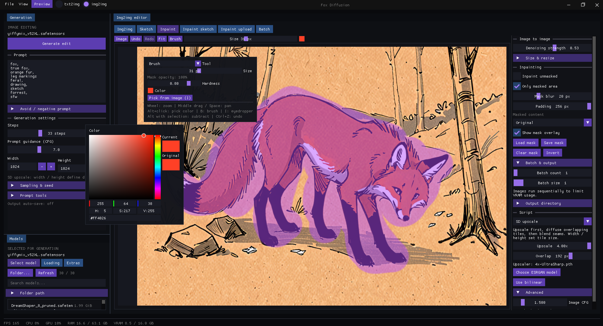

# Fox Diffusion

A minimalist desktop interface for local image generation on Windows.
C++20 · OpenGL · Dear ImGui · stable-diffusion.cpp




## Features

- **txt2img** — positive and negative prompts, LoRA, samplers, schedulers, and seeds.
- **img2img** — painting, inpainting, masks, undo/redo, and batch processing.
- **Image processing** — ESRGAN, tiled upscaling, outpainting, and prompt variations.
- **Workspace** — dockable panels, live previews, generation cancellation, and a gallery.
- **Local storage** — portable settings, PNG/JPEG export, and generation metadata.

See [IMG2IMG.md](IMG2IMG.md) for editor controls and workflows.
No Python is required to run the application or generate images.

## Build

Requires Windows x64, Git, CMake 3.24+, CUDA Toolkit **12.8**, and Visual Studio
with the C++ workload, Windows SDK and MSVC v143 (14.44 tested). NVIDIA's CUDA
compiler is needed at build time; end users do not need a Toolkit installation.

To assemble a local Toolkit without installing it system-wide:

```powershell
./scripts/bootstrap-cuda.ps1
```

The script downloads NVIDIA's pinned CUDA 12.8 Update 1 redistributables and
checks SHA-256 before extraction. In an x64 Native Tools prompt for MSVC v143,
with Ninja on PATH:

```powershell
cmake -S . -B build/static -G Ninja -DCMAKE_BUILD_TYPE=Release -DCUDAToolkit_ROOT="$PWD/build/toolchain/cuda" -DCMAKE_CUDA_COMPILER="$PWD/build/toolchain/cuda/bin/nvcc.exe"
cmake --build build/static --config Release -j 6
```

For an installed Toolkit with Visual Studio integration, the Visual Studio
2022 generator (`-G "Visual Studio 17 2022" -A x64`) is also supported by CMake.
Keep existing `build/Release/` installations intact; use a separate build tree.
The local verification build uses `-DCMAKE_CUDA_ARCHITECTURES=89` for RTX 4080;
omit that override for GGML's portable architecture set.

CMake populates `lib/` with pinned upstream GLFW, Dear ImGui, stb and
stable-diffusion.cpp checkouts. The engine revision is `c678dfe704a2230342376b46add9c8ca736a653d`;
its GGML submodule is `f583f393cd5dfdc129360bbf75cb3d49ccc837a8`.
For an existing engine checkout whose GGML directory is empty, run before configuring:

```powershell
git -C lib/stable-diffusion.cpp submodule update --init ggml
```

Third-party sources are unmodified. Update the pinned engine and its C API
integration together; rebuilding the EXE also rebuilds the embedded engine.

## Portable engine

stable-diffusion.cpp, GGML CPU/CUDA backends, CUDA runtime and the VC++ runtime
are linked statically. There is no engine subprocess, inference HTTP endpoint,
preview bridge or dynamically loaded GGML plugin. Progress and preview pixels
arrive through C callbacks; cancellation uses `sd_cancel_generation`.

Copy **only `fox-diffusion.exe`** into a writable folder. The UI opens before
GPU initialization. The footer displays the driver's maximum CUDA version,
which is distinct from the engine's CUDA 12.8 build version. A driver reporting
less than CUDA 12.8, or a missing driver, produces a warning and rejects GPU work.

On the first GPU request, the app checks the GPU, downloads the pinned NVIDIA
cuBLAS 12.8.4.1 archive over HTTPS, verifies SHA-256 and extracts only the two
required DLLs and license into `cuda-bin/`. Later processes verify and reuse
these local DLLs without network access. Interrupted downloads can be retried;
the verified archive is retained in `cache/` for repair. cuBLAS and the system
CUDA driver are delay-loaded, while cudart is static.

```text
portable-folder/
├── fox-diffusion.exe
├── config/
├── cache/
├── output/
└── cuda-bin/
    ├── cublas64_12.dll
    ├── cublasLt64_12.dll
    └── LICENSE
```

The first download is approximately 564 MB; allow additional disk space for
the extracted DLLs. Model files remain separate and can be selected anywhere.
The app never installs or changes the system NVIDIA driver. Own settings,
cache, temporary extraction files and default outputs are relative to the EXE.
An explicitly selected output directory is honored.

Cancellation during sampling is cooperative; an in-flight GPU operation must
return first. Model loading and an ESRGAN tile finish before cancellation can
release their resources. Callbacks are removed before the owning backend dies.

## First run

```powershell
.\build\static\fox-diffusion.exe
```

1. In **Models**, select your model folder and refresh the list.
2. Choose an SD 1.x or SDXL model (`.safetensors` / `.ckpt`).
3. In **txt2img**, enter a prompt, set the image dimensions, and click **Generate image**.
4. Switch to **img2img** to work with an existing image.

Models can be stored outside the application folder. Configure LoRA and
additional components in Models. Qwen requires separate components;
see the [editor guide](IMG2IMG.md).

Settings and window layout are stored in `config/settings.ini` and
`config/layout.ini` next to the executable. Existing INI files beside the
executable are read if the new files are absent. Images are saved in `output/`. Configure automatic saving in
**File → Settings**, or save a result manually.

## Verification

Run image processing tests without a model:

```powershell
ctest --test-dir build/static -C Release --output-on-failure
```

The inference smoke test requires a compatible NVIDIA GPU and a model:

```powershell
.\build\static\img2img-smoke.exe "D:\Models\model.safetensors" 1024
```

An optional third argument specifies an ESRGAN model path. The smoke test covers
txt2img, live preview, img2img, protected inpaint pixels, tiled upscaling,
cancellation during active sampling, and generation after cancellation.
`cuda-runtime-smoke.exe prepare` exercises runtime installation and reuse;
without arguments it checks that startup has not loaded cuBLAS/cudart DLLs.
See [GPU validation](docs/static-engine-validation.md) for the recorded run.

## Dependencies

[GLFW](https://github.com/glfw/glfw) ·
[Dear ImGui](https://github.com/ocornut/imgui) ·
[stb](https://github.com/nothings/stb) ·
[stable-diffusion.cpp](https://github.com/leejet/stable-diffusion.cpp)
