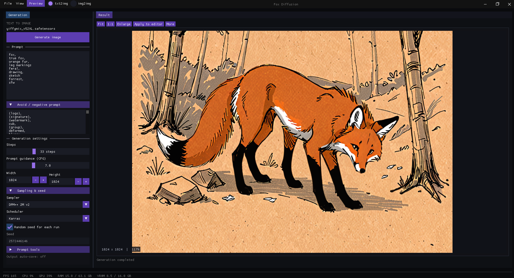

# Fox Diffusion

A minimalist desktop interface for local image generation on Windows.
C++20 · OpenGL · Dear ImGui · stable-diffusion.cpp



## Features

- **txt2img** — positive and negative prompts, LoRA, samplers, schedulers, and seeds.
- **img2img** — painting, inpainting, masks, undo/redo, and batch processing.
- **Image processing** — ESRGAN, tiled upscaling, outpainting, and prompt variations.
- **Workspace** — dockable panels, live previews, generation cancellation, and a gallery.
- **Local storage** — portable settings, PNG/JPEG export, and generation metadata.

See [IMG2IMG.md](IMG2IMG.md) for editor controls and workflows.
No Python is required to run the application or generate images.

## Build

Requires Windows x64, Git, CMake 3.24+, and Visual Studio with the
**Desktop development with C++** workload and Windows SDK.

From the project root, using Visual Studio 2022:

```powershell
cmake -S . -B build -G "Visual Studio 17 2022" -A x64
cmake --build build --config Release
```

For Visual Studio 2026, use the `Visual Studio 18 2026` generator with a CMake
version that supports it. On first configuration, CMake downloads GLFW,
Dear ImGui, and stb from their official repositories. Dependencies are pinned
in [CMakeLists.txt](CMakeLists.txt).

## Engine setup

Generation runs through [stable-diffusion.cpp](https://github.com/leejet/stable-diffusion.cpp).
The NVIDIA backend uses Windows x64 CUDA 12 and requires a compatible NVIDIA driver.

1. Open [release master-889-c678dfe](https://github.com/leejet/stable-diffusion.cpp/releases/tag/master-889-c678dfe),
   pinned in [runtime-manifest.json](backend/runtime-manifest.json).
2. Download the [CUDA 12 engine](https://github.com/leejet/stable-diffusion.cpp/releases/download/master-889-c678dfe/sd-master-c678dfe-bin-win-cuda12-x64.zip)
   and [CUDA runtime libraries](https://github.com/leejet/stable-diffusion.cpp/releases/download/master-889-c678dfe/cudart-sd-bin-win-cu12-x64.zip).
3. Extract both archives into `build/Release/backend/`. Keep `sd-server.exe`,
   `sd-cli.exe`, and their DLLs together. Do not mix libraries from different releases.
4. Keep the built `preview-bridge.dll` next to `fox-diffusion.exe`.

```text
build/Release/
├── fox-diffusion.exe
├── preview-bridge.dll
└── backend/
    ├── sd-server.exe
    ├── sd-cli.exe
    ├── stable-diffusion.dll
    └── … remaining DLLs from both archives
```

Engine files can also be placed directly next to the application.
The engine and model weights are installed separately and are not included
in this repository. Other versions are available in the
[official releases](https://github.com/leejet/stable-diffusion.cpp/releases);
their API compatibility with this interface must be checked separately.

## First run

```powershell
.\build\Release\fox-diffusion.exe
```

1. In **Models**, select your model folder and refresh the list.
2. Choose an SD 1.x or SDXL model (`.safetensors` / `.ckpt`).
3. In **txt2img**, enter a prompt, set the image dimensions, and click **Generate image**.
4. Switch to **img2img** to work with an existing image.

Models can be stored outside the application folder. Configure LoRA and
additional components in Models. Qwen requires separate components;
see the [editor guide](IMG2IMG.md).

Settings (`settings.ini`), window layout (`layout.ini`), and the `output/`
folder are stored next to the executable. Configure automatic saving in
**File → Settings**, or save a result manually.

## Verification

Run image processing tests without a model:

```powershell
ctest --test-dir build -C Release --output-on-failure
```

The inference smoke test requires an installed engine and model:

```powershell
.\build\Release\img2img-smoke.exe "D:\Models\model.safetensors" 1024
```

An optional third argument specifies an ESRGAN model path.

## Dependencies

[GLFW](https://github.com/glfw/glfw) ·
[Dear ImGui](https://github.com/ocornut/imgui) ·
[stb](https://github.com/nothings/stb) ·
[stable-diffusion.cpp](https://github.com/leejet/stable-diffusion.cpp)

Only the engine's required C API header and its
[MIT license](third_party/sdcpp-api/LICENSE) are included in this repository.
